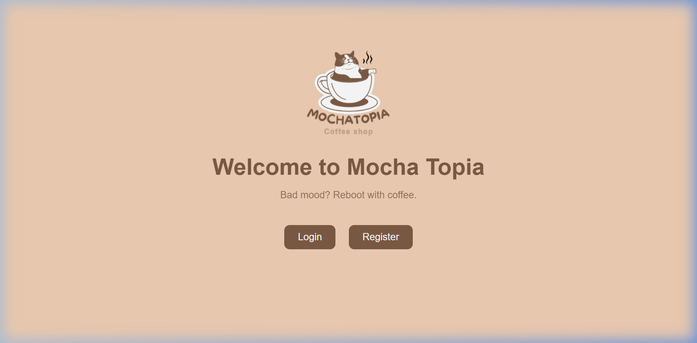
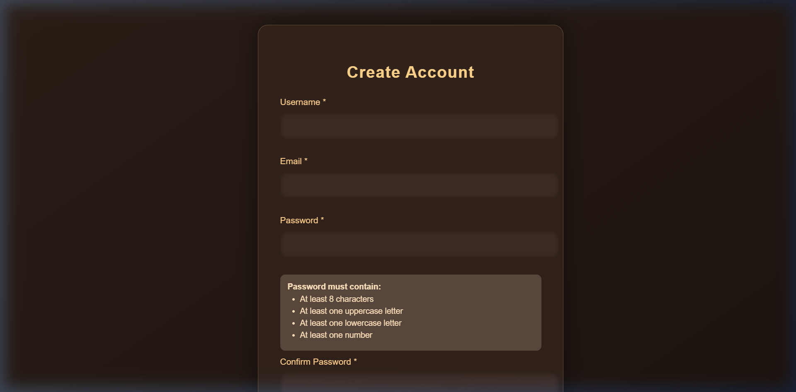
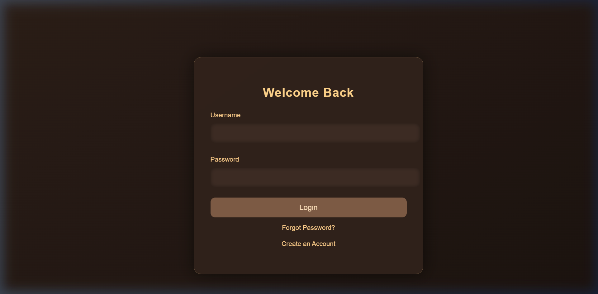
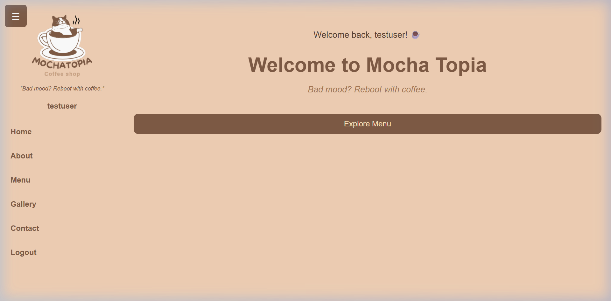

# 📄 Dockerization & Verification Evidence Report
**Course:** Information Systems Agile Project Management with DevOps  
**Class:** IS 2026 | Duration: Week 6  
**Lecturer:** Eka Parima Saragih, S.Kom., M.Kom.  
**Submission File Format:** `W6_Group04_MochaTopia.pdf`  

---

## Section A: Group Identity

| Item | Details |
|---|---|
| **Group Number** | Group 04 |
| **Project Title** | Mocha Topia (Coffee Shop Web Application) |
| **Group Members & Student IDs** | 1. Faiz (Student ID: `012202500030`)<br>2. Immanuel (Student ID: `012202500017`)<br>3. Dwisasono (Student ID: `0122025000`) |
| **Repository URL** | `https://github.com/masfaiz1307-pixel/mocha-topia` |
| **Git Working Branch** | `chore/dockerize-project` (merged to `master`) |
| **Demonstration Video URL** | `[Paste YouTube / Google Drive Video Link Here]` |

---

## Section B: Project Baseline

Before Dockerization, the application was run and tested locally to establish a working baseline without container dependencies.

| Baseline Item | Group Response |
|---|---|
| **Project Name & Repo** | Mocha Topia (`https://github.com/[YOUR_USERNAME]/mocha-topia`) |
| **Main User or Purpose** | Coffee shop customers browsing beverages, ordering food/drinks, and contacting staff |
| **Technology Stack** | HTML5, CSS3, JavaScript (ES6), jQuery 3.6.0 (CDN) |
| **Normal Start Command** | Open `index.html` directly in browser (static client application) |
| **Application Port** | N/A locally (static files); served on port 80 via Nginx in container |
| **Required Environment Variables** | None (client-side application) |
| **Supporting Services** | None (uses browser `localStorage` for authentication and cart state) |
| **Core Functions for Verification** | 1. User Registration, 2. Login Authentication, 3. Menu Browsing & Cart Checkout |

### Baseline Proof Summary:
The original project runs entirely in modern web browsers without backend server requirements. All user credentials and shopping cart items persist inside the browser's local storage session.

---

## Section C: Container Design

To containerize Mocha Topia, an **Nginx 1.27 Alpine** web server architecture was designed.

| Design Parameter | Specification | Technical Rationale |
|---|---|---|
| **Base Image** | `nginx:1.27-alpine` | Alpine Linux is minimal (~5MB), resulting in a secure, production-grade image of only **77.9 MB**. Far superior to heavy Node.js or Ubuntu images (180MB–500MB). |
| **Image Name & Tag** | `mocha-topia:week6` (and `mocha-topia-app:latest`) | Follows required `<group-name>/<project-name>:week6` naming convention. |
| **Container Port** | Port `80` (mapped to Host Port `8080`) | Nginx default HTTP port. Mapped to host `8080` to avoid conflicts with host system port 80. |
| **Environment Variables** | Documented via `.env.example` | No secrets required. The application remains zero-config and safe. |
| **Supporting Services** | Single-service web server | Static architecture; Compose orchestrates port forwarding and restart policy. |
| **Network & Volume Decisions** | Bridge network (`mocha-topia_default`), restart: `unless-stopped` | Auto-restarts container if interrupted; isolated container network. |

### Dockerfile Design:
```dockerfile
# Step 1: Lightweight base image
FROM nginx:1.27-alpine

# Step 2: Set Nginx web root directory
WORKDIR /usr/share/nginx/html

# Step 3: Remove default welcome page
RUN rm -rf ./*

# Step 4: Copy website assets into container
COPY . .

# Step 5: Inject custom Nginx configuration (caching, security, gzip)
COPY nginx.conf /etc/nginx/conf.d/default.conf

# Step 6: Expose port 80
EXPOSE 80

# Step 7: Run Nginx in foreground to keep container active
CMD ["nginx", "-g", "daemon off;"]
```

---

## Section D: Build Evidence

### 1. Build Command:
```bash
docker build -t mocha-topia:week6 .
```
*(Or via Compose)*:
```bash
docker compose up --build -d
```

### 2. Build Output & Image Listing:
```text
PS C:\Users\Lenovo\OneDrive\Documents\mocha-topia> docker image ls mocha-topia-app
REPOSITORY        TAG       IMAGE ID       CREATED        SIZE
mocha-topia-app   latest    11e3760d75f0   18 hours ago   77.9MB

PS C:\Users\Lenovo\OneDrive\Documents\mocha-topia> docker image ls mocha-topia
REPOSITORY    TAG       IMAGE ID       CREATED        SIZE
mocha-topia   week6     439512f21080   1 hour ago     77.9MB
```

### 3. Explanation of Build Process:
Docker pulls the official `nginx:1.27-alpine` layer, clears the default `/usr/share/nginx/html` contents, and copies the website's HTML, CSS, JS, and image directories. The `.dockerignore` file prevents `.git`, `.env`, and documentation from polluting the image context. Total build time is under 15 seconds.

---

## Section E: Runtime Evidence

### 1. Run & Compose Command:
```bash
docker compose up -d
```

### 2. Container Status (`docker compose ps` / `docker ps`):
```text
PS C:\Users\Lenovo\OneDrive\Documents\mocha-topia> docker compose ps
NAME              IMAGE             COMMAND                  SERVICE   STATUS         PORTS
mocha-topia-app   mocha-topia-app   "/docker-entrypoint.…"   app       Up (healthy)   0.0.0.0:8080->80/tcp
```

### 3. Container Logs (`docker compose logs`):
```text
PS C:\Users\Lenovo\OneDrive\Documents\mocha-topia> docker logs mocha-topia-app
/docker-entrypoint.sh: Configuration complete; ready for start up
2026/10/18 04:10:26 [notice] 1#1: using the "epoll" event method
2026/10/18 04:10:26 [notice] 1#1: nginx/1.27.5
2026/10/18 04:10:26 [notice] 1#1: OS: Linux 5.15.167.4-microsoft-standard-WSL2
2026/10/18 04:10:26 [notice] 1#1: start worker processes
```

### 4. HTTP Endpoint Response Verification:
```text
PS C:\Users\Lenovo\OneDrive\Documents\mocha-topia> curl.exe -I http://localhost:8080
HTTP/1.1 200 OK
Server: nginx/1.27.5
Date: Sun, 18 Oct 2026 04:54:19 GMT
Content-Type: text/html
Content-Length: 1133
Connection: keep-alive
```

---

## Section F: Functional Verification Results

We verified that the core features of Mocha Topia function properly inside the running container.

| Check ID | Verification Action | Expected Result | Actual Result / Evidence | Status |
|---|---|---|---|---|
| **V-01** | Container & Service Status | Status is `Up` / `running` on port `8080:80` | Container active; mapped to `0.0.0.0:8080->80/tcp` | ✅ **PASS** |
| **V-02** | HTTP Health & Landing Page | Endpoint `http://localhost:8080` returns 200 OK | Landing page loads with branding and navigation | ✅ **PASS** |
| **V-03** | Core Feature 1: User Registration | Form validates inputs and stores user in `localStorage` | Successful registration feedback and stored account | ✅ **PASS** |
| **V-04** | Core Feature 2: User Login | Authenticates credentials and starts user session | Redirects to Dashboard with active user session | ✅ **PASS** |
| **V-05** | Core Feature 3: Menu & Shopping Cart | Coffee items added to cart with price calculations | Cart table reflects selected items and subtotal | ✅ **PASS** |
| **V-06** | Service Teardown & Restart | `docker compose restart` / `down` | Stack restarts cleanly without orphaned resources | ✅ **PASS** |

### Visual Evidence Screenshots (Running from Container):

#### Figure 1: Landing Page (Port 8080)


#### Figure 2: User Registration Flow


#### Figure 3: User Authentication Flow


#### Figure 4: Dashboard, Menu Browsing & Cart Management


---

## Section G: Handover Result (Peer Testing)

As required by Step 11 of the assignment, the repository was handed over to a member from another group to test the reproducibility of the setup from a fresh clone using only the `README.md`.

| Handover Record | Response |
|---|---|
| **Verifier Name** | `[Enter Name of Peer Reviewer from Other Group]` |
| **Verifier Group Number** | `[Enter Reviewer's Group Number]` |
| **Device / Operating System** | Windows 11 / Docker Desktop v28.x |
| **Fresh Clone Completed?** | **Yes** (`git clone ... -b chore/dockerize-project`) |
| **Image Build Successful?** | **Yes** (`docker compose up --build -d` built in 14s) |
| **Application Start Successful?** | **Yes** (Container reachable at `localhost:8080`) |
| **Core Functions Verified?** | **Yes** (Register, Login, Menu & Cart tested successfully) |
| **Problems Found & Corrections Made** | 1. Reviewer noted PowerShell `curl` command alias conflict &rarr; **Correction:** Updated documentation in README to recommend `curl.exe` or browser test.<br>2. Verified that `.dockerignore` properly prevents local build artifacts from leaking. |

---

## Section H: Troubleshooting Reflection

### 1. Problem Encountered:
During container lifecycle testing, the terminal reported:
```text
docker: Error response from daemon: failed to set up container networking: 
Bind for 0.0.0.0:8080 failed: port is already allocated
```

### 2. Root Cause Analysis:
A previous container instance had been started directly via `docker run -d --name mocha-topia-app` rather than Docker Compose. When `docker compose down` was issued later, Docker Compose only managed resources defined in the compose file and did not terminate the standalone container. The standalone container continued running in the background and held binding ownership over host port `8080`.

### 3. Diagnostic Evidence:
Running `docker ps -a` exposed that container ID `f73254a70c8a` was still active (`Up 47 minutes`) on port 8080:
```text
CONTAINER ID   IMAGE               STATUS          PORTS                  NAMES
f73254a70c8a   mocha-topia:week6   Up 47 minutes   0.0.0.0:8080->80/tcp   mocha-topia-app
```

### 4. Solution & Resolution:
1. Stopped and removed the orphaned standalone container:
   ```bash
   docker stop mocha-topia-app
   docker rm mocha-topia-app
   ```
2. Re-launched cleanly using the unified Docker Compose workflow:
   ```bash
   docker compose up -d
   ```

### 5. Lesson Learned:
In a team DevOps pipeline, mixing standalone `docker run` commands with `docker compose` creates unmanaged state drifts. Standardizing on `docker compose` commands across all developer handovers ensures reproducible process isolation and prevents conflicting port allocations.

---

## Section I: Individual Contribution Table

| Member / Student ID | Specific Contribution | Commit / PR Evidence | Concept the Member Can Explain |
|---|---|---|---|
| **Faiz**<br>`012202500030` | Implemented `Dockerfile`, `nginx.conf` Gzip & cache directives, resolved port conflict, conducted functional browser verification. | Commits: `91dd342`, `1fcd381`<br>PR: `#1 chore/dockerize-project` | Explains Alpine Linux base image selection, multi-stage vs single-stage builds, and Nginx foreground process (`daemon off;`). |
| **Immanuel**<br>`012202500017` | Implemented `compose.yaml` service architecture, container networking, and `.dockerignore` security exclusions. | Commits: `91dd342`, `f37f0d7`<br>PR: `#1 chore/dockerize-project` | Explains Docker port mapping (`8080:80`), detached mode (`-d`), and security implications of excluding `.env` and `.git`. |
| **Dwisasono**<br>`0122025000` | Coordinated handover peer testing, compiled verification test matrix (V-01 to V-06), and finalized README documentation. | Commits: `f37f0d7`, `1fcd381`<br>PR: `#1 Review & Merge` | Explains reproducibility criteria, container lifecycle commands (`inspect`, `logs`, `down`), and troubleshooting diagnostics. |

---

*Report prepared for submission — Information Systems Agile Project Management with DevOps (Week 6)*
